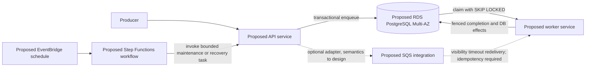

# LeaseQ architecture

## Existing queue

LeaseQ is a local reference queue built on FastAPI, psycopg and PostgreSQL. Claimers select due queued jobs or expired leases with `FOR UPDATE SKIP LOCKED`, update the claim count and random lease capability, and append a claim event in a transaction. PostgreSQL time governs lease comparisons (`clock_timestamp()` is wall-clock time that changes during a statement; transaction timestamps are fixed at transaction start). Concurrent workers avoid blocking on already-claimed rows.

Queued jobs may have priority -100..100 and an absolute timezone-aware
`run_after` or relative `delay_seconds`. Relative time is computed by
PostgreSQL. Eligible jobs order by priority descending, then id ascending, so
the default priority 0 remains FIFO. Claim requests may filter to 1..64 kinds;
omitting the filter preserves the API's all-kind behavior. Bundled and SDK
workers filter to their registered handlers, so unsupported queued kinds wait
for a matching worker instead of being silently completed.

The schema has a partial `jobs_priority_runnable` index for ordered ready
claims and `jobs_kind_queued_due` on `(kind, run_after)` for queued-kind/due
filtering. A local single-host benchmark at 10k, 100k and 1M small rows found
that the additional index changed rare, absent and far-future filtered plans
from scans and sorts to bitmap index plans; at 1M, measured claim p50/p95 fell
from 180–226/242–667 ms to 2.6–3.3/4.0–8.4 ms for those cases. It used about
7.1 MB per million rows in that dataset. This is a workload-specific local
measurement; write amplification, cold-cache behavior, other distributions,
multi-host contention and cloud capacity were not established. See the README
benchmark section for workload definitions and limits.

The random lease capability is checked during completion/failure and fences stale queue writes. `attempts` is the monotonic claim count and remains monotonic on requeue; it is not a numeric fencing token enforced by an arbitrary external side-effect service. Delivery is at least once. A handler may run more than once after a crash or lease expiry.

Queue effects written through the worker's `finish()` helper and the fenced completion are committed in one database transaction. External effects (email, payment, remote API) cannot join that transaction and may happen more than once; use a downstream idempotency key or a service integration designed for that system.

The authenticated core accepts JSON bodies up to 64 KiB (the operator may lower the cap), with a ten-second total body-read deadline. Job rows are read fresh; `/jobs`, `/stats` and `/metrics` share aggregate state counts cached per API process for up to five seconds. `/stats` publishes snapshot time and maximum age in response headers. Token buckets bound authenticated requests to 60,000/minute/address and public requests to 120/minute/address by default. Operators may configure the budgets. Health probes have a separate bounded 120/minute/address admission map. These are per-process controls, not global tenant or spending quotas.

The dashboard keeps the bearer token in page memory by default. An explicit
session-storage option retains it until the tab closes; same-origin script can
read it while stored. Forget and any 401 clear the token and sensitive state.
The token is not stored in cookies, localStorage or the URL.

Operator endpoints expose bounded observations: up to 100 worker reports,
including claim-time last-seen, actual valid heartbeat time and current
unexpired leases; and a cached 15-minute metrics window sampling at most 5,000
events/first claims. First-claim wait uses initial availability, excludes
historical rows whose availability is unknown, and returns null percentiles
when there are no samples. Sampling truncation is explicit. These are measured
database events, not process health or capacity estimates.

Bulk requeue/cancel accepts at most 100 IDs per request. The dashboard captures
up to 1,000 matching IDs in one filter snapshot, confirms once and sends
sequential batches. Outcomes are per item; a lost response leaves that batch
`uncertain` because some or all operations may have committed, and later
batches are `not_attempted`. The client does not retry an uncertain mutation
automatically.

Durable schedules store numeric five-field UTC cron state in PostgreSQL using
the pinned `croniter==7.0.0`. The API poller checks once per second and dispatches
at most ten due schedules under row locks, atomically inserting the occurrence
and advancing `next_run_at`. Missed slots coalesce to one occurrence; no
unbounded catch-up is attempted. Scheduling requires a running API poller, and
execution requires workers. Same-key schedule retries return the original
schedule; a new intent uses a fresh idempotency key.

## Real chaos console status

The sandbox gateway serves `/console/` and supervises one isolated run: a generated owned PostgreSQL database, an internal original API, four original worker subprocesses, at most 128 jobs, three extra fixed batches and a ten-minute monotonic deadline. It is bound to loopback; Docker publishes only `127.0.0.1`. Its private API token remains server-side. A separate run capability remains in browser memory. Mutation requests require the capability (except initial creation), same Origin, a custom header, a 64 KiB body cap and ten-second read deadline. The limiter admits ten mutations/minute/address with bounded state; authenticated owner cleanup has reserved admission after quota exhaustion.

Database connection strings are parsed and rebuilt with psycopg. The administrator database name is fixed, run names are generated, routing/service/passfile overrides are rejected, and connect/statement timeouts are bounded. Only registered live children can be killed. Selection locks a real leased row until its chosen process exits; the replacement uses the original worker. Shutdown/startup cancellation reaps owned processes. Unknown databases block new runs and require operator inspection; a name prefix alone never establishes ownership.

Snapshots use a read-only repeatable-read transaction. Recovery, stale-result and DLQ evidence are derived from real event/effect rows; missing observations remain inconclusive. Browser polling is single-flight, preserves last-good data on a clearly marked timeout and supports explicit retry. External stop/expiry clears the client's run data and capability.

## Proposed cloud mapping (not implemented)

The diagram is a deployment concept only. SQS visibility timeout/redelivery does not replace LeaseQ's PostgreSQL lease or make a remote effect transactional. An adapter would need explicit acknowledgement, duplicate handling and failure semantics. RDS Multi-AZ, EventBridge and Step Functions are proposed AWS components; no AWS account, deployment, credentials or service integration exists. Availability-zone failover and recovery objectives require configuration and drills; the labels do not promise them.

## Time and durability

Use database time for lease expiry; worker wall clocks are not the lease authority. A single local PostgreSQL data directory on one disk has no synchronous Multi-AZ replica. A backup/restore procedure exists in `docs/backup-restore.md`, but its prior successful verification is historical evidence, not a current restore guarantee. Proposed service recovery targets must be confirmed by repeated restore and failover drills.

For a future persistent single-region deployment, initial planning targets are RPO at most 24 hours with daily backups and RTO at most 60 minutes after restore begins. Neither target has been validated for a deployed service. The disposable lab intentionally retains no run after reset; its data has no recovery guarantee.
